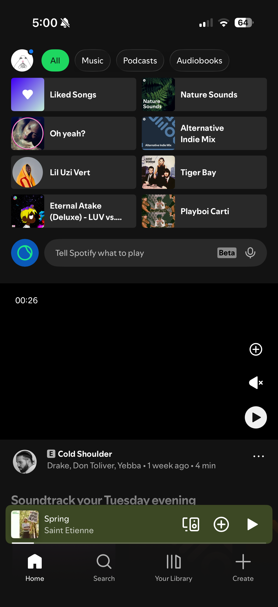
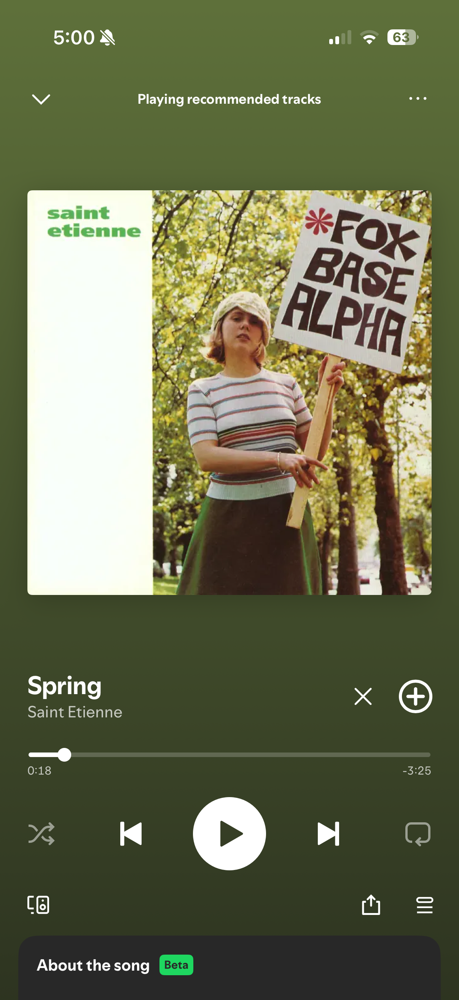

# AND101 Project - Woofify (Animal Version of Spotify)

Submitted by: **Keoni Perez Labrador**

Time spent: **3** hours spent in total

## Summary

**Woofify** is an Android app that reimagines **Spotify** as an "Animal Version" specifically designed for dogs! Features include curated calming tracks, live dog album artwork fetched from the **Dog.ceo API**, custom rounded button shapes, tooltips, custom font resources, and an interactive Now Playing player screen using **MediaPlayer**.

If I had to describe this project in three (3) emojis, they would be: 🐕 🎵 ✨

---

## 📸 Original App Screenshot to Duplicate

Below is the screenshot of the original **Spotify** app layout selected to duplicate into an Animal Version:

*(Original app layout choice: Spotify Music Player)*

---

## Application Features

### Required Features
- [x] **Pick an app screenshot to duplicate**: Selected Spotify music player screenshot displayed above.
- [x] **Create a runnable app displaying an Animal Version**: Built **Woofify (Spotify for Dogs)** with live dog album art and calming audio streams.
- [x] **Layout uses one (1) or more ConstraintLayout**: Root layouts in `activity_main.xml`, `item_dog_track.xml`, and `activity_track_detail.xml` use `ConstraintLayout`.
- [x] **Layout uses one (1) or more ImageView**: Album art displayed via `ImageView` (`track_image` and `detail_track_image`).
- [x] **Layout uses three (3) or more TextViews**: Each row and detail view displays 3+ `TextView`s (Track Title, Artist/Playlist, Duration, Status).

### Stretch Features
- [x] **Create a custom-shape Button using Shape Drawables**: Implemented rounded button background in `res/drawable/rounded_button.xml`.
- [x] **Customize text fonts by creating new Font Resources**: Added font resource in `res/font/custom_font.xml`.
- [x] **Add Tooltips to Views**: Added `android:tooltipText` to buttons and image views for navigation guidance.
- [x] **Create a second layout for an original app idea**: Created a "Now Playing Player" layout in `activity_track_detail.xml` shown below.

---

## 🎨 Original App Layout (Second Screen)

Below is the layout for the second screen layout (`IMG_6335`):

---

## 🎬 Video Demo

Here's a video demo showing the runnable app:

[Loom Video Demo](https://www.loom.com/share/95ca9b79204e4d2ca9e55ac99501e401)

---

## License

Copyright 2026 **Keoni Perez Labrador**

Licensed under the Apache License, Version 2.0 (the "License");
you may not use this file except in compliance with the License.
You may obtain a copy of the License at

    http://www.apache.org/licenses/LICENSE-2.0

Unless required by applicable law or agreed to in writing, software
distributed under the License is distributed on an "AS IS" BASIS,
WITHOUT WARRANTIES OR CONDITIONS OF ANY KIND, either express or implied.
See the License for the specific language governing permissions and
limitations under the License.
